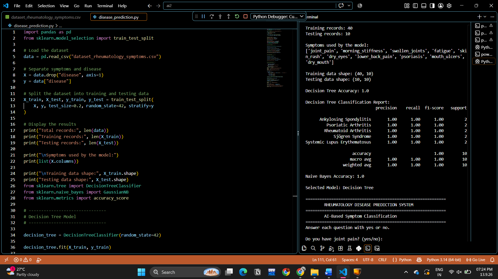
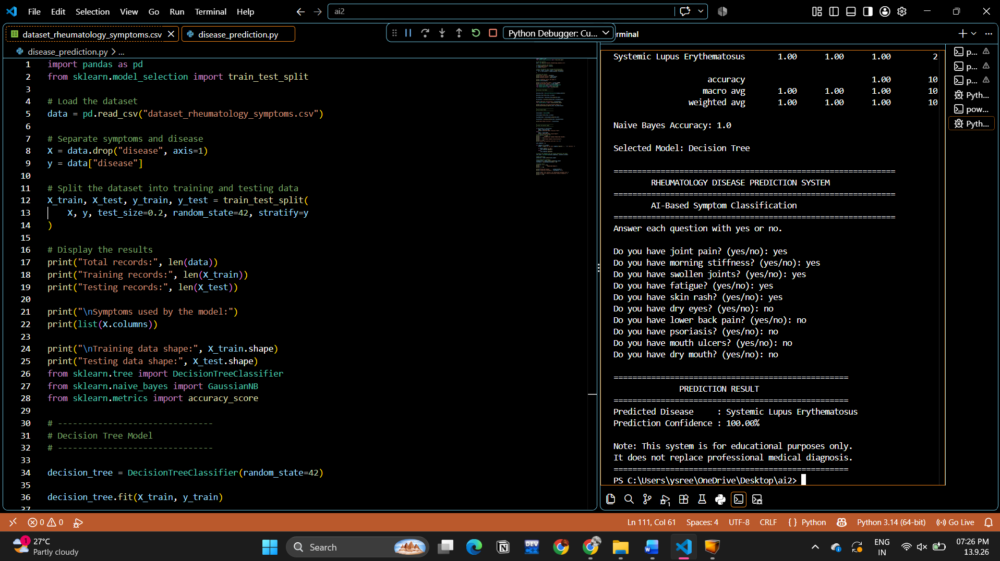

Rheumatology Disease Prediction System

Overview

The Rheumatology Disease Prediction System is a machine learning project designed to predict possible rheumatological diseases based on reported symptoms. It uses classification algorithms to analyze symptom data and generate predictions.

This project demonstrates the application of machine learning techniques to a healthcare-related classification problem.

Objectives

* Analyze symptom data related to rheumatological diseases.
* Apply machine learning classification algorithms.
* Compare predictions generated by different models.
* Demonstrate how machine learning can be applied to healthcare datasets.

Technologies Used

* Programming Language: Python
* Libraries: Pandas, NumPy, Scikit-learn
* Machine Learning Algorithms: Decision Tree and Gaussian Naive Bayes
* Dataset: CSV file

Project Structure

rheumatology-disease-prediction/
│
├── data/
│   └── dataset_rheumatology_symptoms.csv
│
├── screenshots/
│   ├── Screenshot1.png
│   └── Screenshot2.png
│
├── src/
│   └── main.py
│
├── README.md
└── requirements.txt

Dataset

The dataset is stored in data/dataset_rheumatology_symptoms.csv.

It contains symptom-related data used by the machine learning models for classification and prediction.

Machine Learning Algorithms

1. Decision Tree

A Decision Tree is a supervised machine learning algorithm that uses decision rules to classify input data.

2. Gaussian Naive Bayes

Gaussian Naive Bayes is a probabilistic classification algorithm that applies Bayes’ theorem and assumes that numerical features follow a Gaussian distribution within each class.

Implementation

The Python implementation is located in src/main.py.

The project uses the dataset to perform symptom-based classification using the implemented machine learning algorithms.

Installation and Execution

Prerequisites

* Python 3.x
* pip

Step 1: Clone the repository

git clone <your-repository-url>

Step 2: Navigate to the project directory

cd rheumatology-disease-prediction

Step 3: Install dependencies

pip install -r requirements.txt

Step 4: Run the program

python src/main.py

Screenshots

Screenshot 1

Screenshot 2

Applications

* Demonstrating machine learning classification using symptom data.
* Exploring the use of data-driven techniques in healthcare-related projects.
* Learning how supervised machine learning algorithms can classify medical datasets.

Limitations

* Predictions depend on the quality and coverage of the dataset.
* The model’s output may not be accurate for every individual.
* The project is intended for educational purposes and is not a substitute for professional medical diagnosis.

Future Enhancements

* Expand the dataset with additional validated samples.
* Evaluate and compare model performance using suitable classification metrics.
* Improve the prediction interface and overall usability.
* Explore additional machine learning algorithms.

Disclaimer

This project is intended for educational purposes only. Its predictions must not be used as a substitute for professional medical advice, diagnosis, or treatment.
